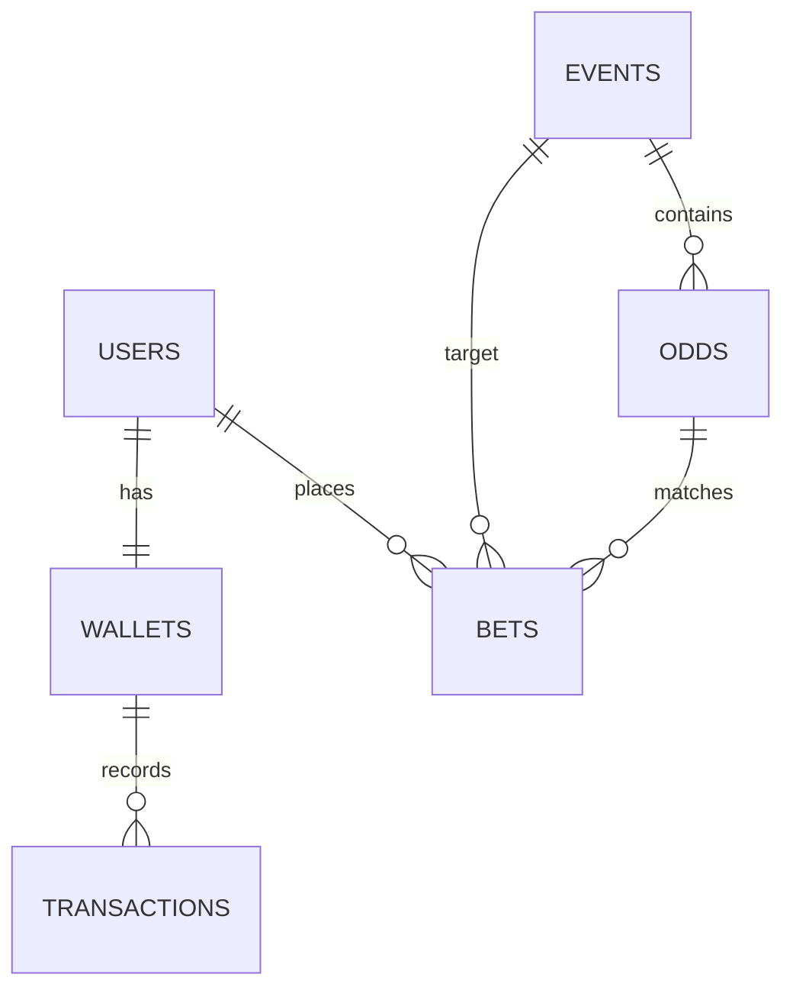

# Implementation Plan: Real-Time Betting Engine (Spring Boot + Thymeleaf)

This plan outlines the design, architecture, database schemas, messaging architecture, and step-by-step construction of a production-grade, highly concurrent sports betting application.

---

## 🏗️ Architecture Design & Flow

### 1. Database Schema
To handle high concurrency and financial transactions safely, we use PostgreSQL with explicit indexing, strict constraints, and **Optimistic Locking** on wallets and odds.

#### SQL Schema Details (`sql/schema.sql`)
- **`users`**:
  - `id` (UUID, Primary Key)
  - `username` (VARCHAR(50), Unique, Indexed)
  - `email` (VARCHAR(100), Unique)
  - `password` (VARCHAR(100))
  - `role` (VARCHAR(20), e.g., 'USER', 'ADMIN')
  - `created_at` (TIMESTAMP)
- **`wallets`**:
  - `id` (UUID, Primary Key)
  - `user_id` (UUID, Foreign Key, Unique, Indexed)
  - `balance` (NUMERIC(15,2), Check >= 0)
  - `currency` (VARCHAR(3), Default 'USD')
  - `version` (INT, Optimistic Lock Version)
- **`transactions`**:
  - `id` (UUID, Primary Key)
  - `wallet_id` (UUID, Foreign Key, Indexed)
