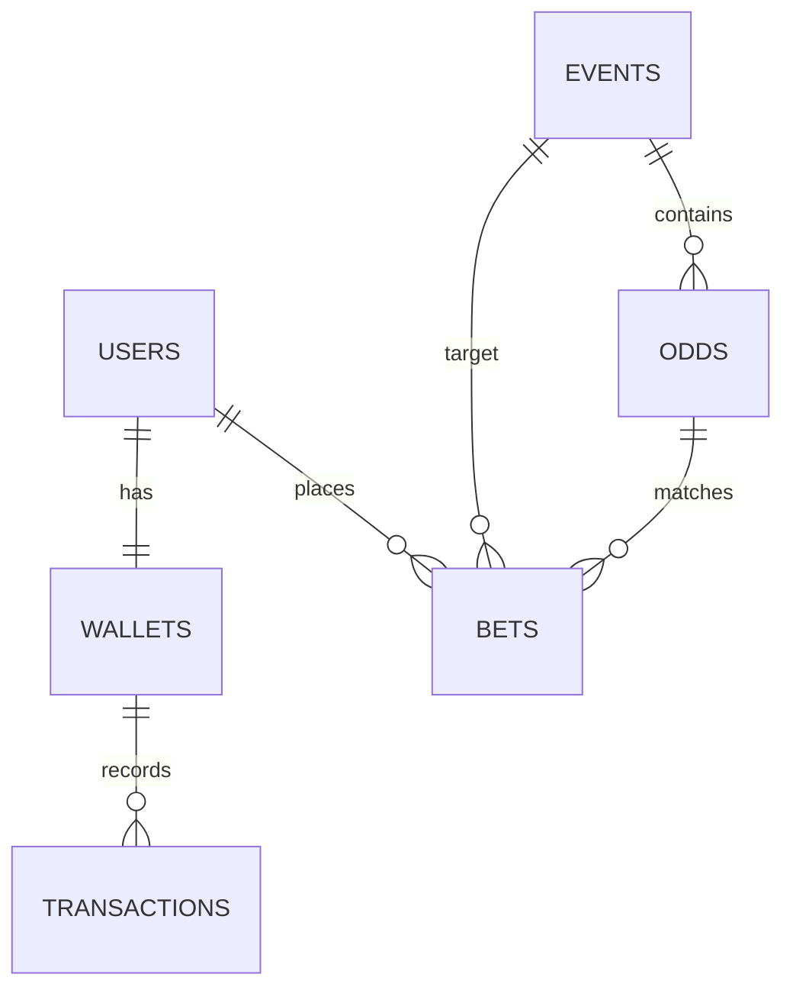

# Implementation Plan: Real-Time Betting Engine (Spring Boot + Thymeleaf)

This plan outlines the design, architecture, database schemas, messaging architecture, and step-by-step construction of a production-grade, highly concurrent sports betting application.

---

## 🏗️ Architecture Design & Flow

### 1. Database Schema
To handle high concurrency and financial transactions safely, we use PostgreSQL with explicit indexing, strict constraints, and **Optimistic Locking** on wallets and odds.

#### SQL Schema Details (`sql/schema.sql`)
- **`users`**:
  - `id` (UUID, Primary Key)
  - `username` (VARCHAR(50), Unique, Indexed)
  - `email` (VARCHAR(100), Unique)
  - `password` (VARCHAR(100))
  - `role` (VARCHAR(20), e.g., 'USER', 'ADMIN')
  - `created_at` (TIMESTAMP)
- **`wallets`**:
  - `id` (UUID, Primary Key)
  - `user_id` (UUID, Foreign Key, Unique, Indexed)
  - `balance` (NUMERIC(15,2), Check >= 0)
  - `currency` (VARCHAR(3), Default 'USD')
  - `version` (INT, Optimistic Lock Version)
- **`transactions`**:
  - `id` (UUID, Primary Key)
  - `wallet_id` (UUID, Foreign Key, Indexed)
  - `type` (VARCHAR(20), e.g., 'DEPOSIT', 'WITHDRAW', 'BET_PLACED', 'BET_SETTLED', 'BET_REFUNDED')
  - `amount` (NUMERIC(15,2))
  - `reference_id` (UUID, Nullable, e.g., Bet ID or external Payment ID)
  - `description` (TEXT)
  - `created_at` (TIMESTAMP)
- **`events`**:
  - `id` (UUID, Primary Key)
  - `sport` (VARCHAR(50), Indexed)
  - `home_team` (VARCHAR(100))
  - `away_team` (VARCHAR(100))
  - `home_score` (INT, Default 0)
  - `away_score` (INT, Default 0)
  - `status` (VARCHAR(20), e.g., 'SCHEDULED', 'LIVE', 'SUSPENDED', 'FINISHED', Indexed)
  - `start_time` (TIMESTAMP, Indexed)
  - `ended_at` (TIMESTAMP, Nullable)
- **`odds`**:
  - `id` (UUID, Primary Key)
  - `event_id` (UUID, Foreign Key, Indexed)
  - `market_name` (VARCHAR(50), e.g., '1X2', 'OVER_UNDER')
  - `selection_name` (VARCHAR(50), e.g., 'HOME_WIN', 'DRAW', 'AWAY_WIN')
  - `odds_value` (NUMERIC(6,2), Check > 1.0)
  - `status` (VARCHAR(20), e.g., 'ACTIVE', 'SUSPENDED')
  - `version` (INT, Optimistic Lock Version)
- **`bets`**:
  - `id` (UUID, Primary Key)
  - `user_id` (UUID, Foreign Key, Indexed)
  - `event_id` (UUID, Foreign Key, Indexed)
  - `odds_id` (UUID, Foreign Key)
  - `selection_name` (VARCHAR(50))
  - `odds_value` (NUMERIC(6,2))
  - `stake` (NUMERIC(15,2))
  - `potential_payout` (NUMERIC(15,2))
  - `status` (VARCHAR(20), e.g., 'PENDING', 'WON', 'LOST', 'VOIDED', Indexed)
  - `placed_at` (TIMESTAMP)
  - `settled_at` (TIMESTAMP, Nullable)

---

### 2. Kafka Event Flow
